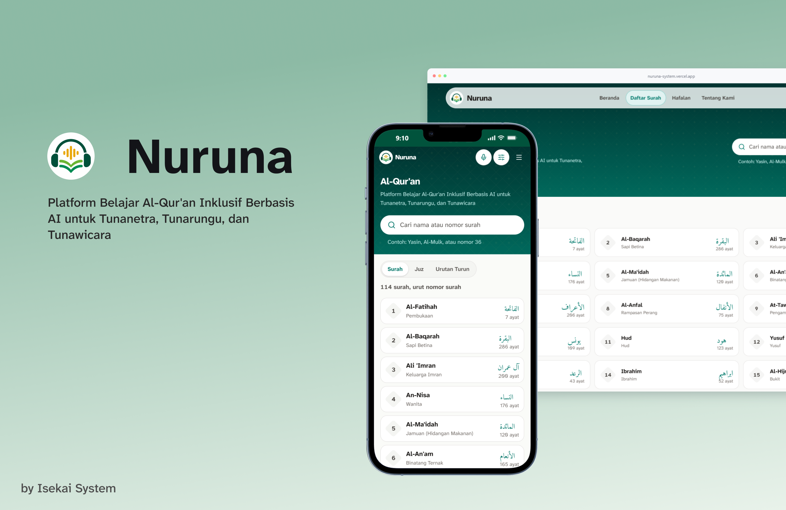
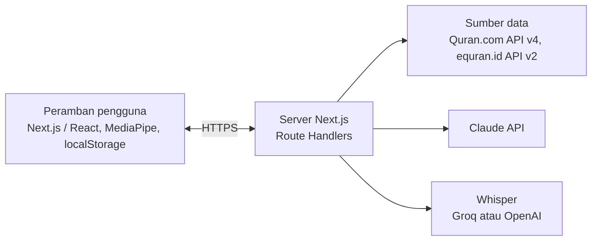

# Nuruna

Platform belajar Al-Qur'an yang inklusif untuk **tunanetra**, **tunarungu**, **tunawicara**, dan pengguna umum, dengan integrasi AI.

> Karya Web Development pada kompetisi **IT RUSH 2026** · Subtema: *Pendidikan, Tata Kelola, dan Teknologi Inklusif*
>
> **Tim:** [Isekai System] · **Situs:** [https://nuruna-system.vercel.app] · **Video demo:** [isi tautan YouTube Unlisted]



## Daftar Isi

1. [Latar Belakang dan Permasalahan](#latar-belakang-dan-permasalahan)
2. [Tujuan](#tujuan)
3. [Fitur dan Status Pengembangan](#fitur-dan-status-pengembangan)
4. [Penggunaan Kecerdasan Artifisial](#penggunaan-kecerdasan-artifisial)
5. [Stack](#stack)
6. [Library, Aset, dan Sumber Terbuka](#library-aset-dan-sumber-terbuka)
7. [Arsitektur dan Struktur Aplikasi](#arsitektur-dan-struktur-aplikasi)
8. [Menjalankan](#menjalankan)
9. [Pengujian dan Kualitas Kode](#pengujian-dan-kualitas-kode)
10. [Sumber Data](#sumber-data)
11. [Akun Demo](#akun-demo)
12. [Aksesibilitas](#aksesibilitas)
13. [Privasi dan Keamanan](#privasi-dan-keamanan)
14. [Keterbatasan dan Rencana Pengembangan](#keterbatasan-dan-rencana-pengembangan)
15. [Tim dan Kontribusi](#tim-dan-kontribusi)
16. [Lisensi](#lisensi)

## Latar Belakang dan Permasalahan

Pembelajaran Al-Qur'an pada umumnya bertumpu pada tiga kemampuan, yaitu membaca teks Arab secara visual, mendengarkan bacaan atau koreksi guru, dan melafalkan ayat secara lisan. Bagi penyandang disabilitas, satu atau lebih dari ketiga jalur tersebut dapat menjadi hambatan sehingga proses belajar secara mandiri menjadi lebih sulit. Kebutuhan setiap kelompok pengguna berbeda: tunanetra dan penyandang penglihatan rendah memerlukan teks yang dapat diperbesar dan antarmuka yang kompatibel dengan pembaca layar; tunarungu memerlukan padanan visual atas informasi yang lazimnya disampaikan melalui suara; tunawicara memerlukan cara berlatih yang tidak mensyaratkan pelafalan lisan. Kebutuhan tersebut merupakan hasil analisis tim dan belum divalidasi melalui uji pengguna.

Perkembangan kecerdasan artifisial (*Artificial Intelligence*, AI) membuka peluang pemanfaatan pengenalan suara dan penjelasan berbahasa alami. Namun, pada konteks keagamaan, keluaran model bahasa dapat tampak meyakinkan tetapi keliru, sedangkan keaslian teks Al-Qur'an harus terjaga. Oleh karena itu, Nuruna menempatkan AI sebagai pembantu yang dibatasi dan berpijak pada sumber terverifikasi, bukan sebagai penentu isi maupun penilai akhir.

## Tujuan

1. Menyediakan aplikasi web belajar Al-Qur'an dengan empat mode belajar (Tunanetra, Tunarungu, Tunawicara, dan Umum) yang pengaturannya dapat disesuaikan pengguna.
2. Menyediakan fitur setoran hafalan suara yang penilaiannya dilakukan melalui pencocokan dengan teks terverifikasi, bukan oleh AI.
3. Menyediakan tutor AI yang jawabannya hanya bersumber dari terjemahan dan Tafsir Kemenag serta mengarahkan pengguna kepada guru atau ustadz untuk persoalan hukum.
4. Menerapkan prinsip aksesibilitas WCAG 2.2 level AA dan prinsip privasi sejak tahap perancangan.

## Fitur dan Status Pengembangan


| Fitur | Deskripsi | Status |
| ----- | --------- | ------ |
| Mode belajar | Empat mode yang memasang preset pengaturan tanpa mengunci; pilihan disimpan di peramban. | Tersedia |
| Daftar surah | 114 surah dengan pencarian berdasarkan nama, arti, atau nomor, serta tampilan per juz. | Tersedia |
| Pembaca Al-Qur'an | Teks Arab, terjemahan Kemenag, dan murottal berurutan per ayat; pilihan ukuran teks, arti per kata, warna tajwid, kontras tinggi, dan pintasan keyboard. | Tersedia |
| Tafsir Kemenag | Tafsir per ayat yang dimuat ketika ayat dibuka. | Tersedia |
| Mode hafalan | Teks Arab disembunyikan; kata dapat diintip satu per satu. | Tersedia |
| Setoran hafalan suara | Perekaman bacaan, transkripsi Whisper, pencocokan dengan teks terverifikasi, dan hasil per kata (benar, salah, terlewat, tambahan). | Tersedia |
| Bahasa sederhana | Penyederhanaan tafsir dengan kalimat pendek; tafsir asli tetap ditampilkan. | Tersedia |
| Perintah suara | Pembukaan surah dan ayat, pemutaran, jeda, tafsir, dan setoran melalui ucapan; seluruhnya juga dapat dilakukan lewat tombol atau keyboard. | Tersedia |
| Latihan hafalan | Soal susun, lengkapi, dan arti tanpa AI dan tanpa gerakan seret. | Tersedia |
| Belajar isyarat hijaiyah | Pembelajaran 30 huruf dengan mengetuk jawaban; pengenalan isyarat melalui kamera berjalan di peramban. | Tersedia |
| Akun dan progres belajar | Pencatatan setoran dan kuis serta pengulangan berjarak. | Rencana |


## Penggunaan Kecerdasan Artifisial

Gagasan, kode, arsitektur sistem, dan integrasi dirancang secara mandiri oleh tim. Seluruh keluaran AI yang digunakan telah ditinjau dan diverifikasi oleh tim. Uraian ini selaras dengan Surat Pernyataan Orisinalitas dan AI yang diserahkan kepada panitia.

### Dalam proses pengembangan

| Alat | Penggunaan |
| ---- | ---------- |
| Claude (Anthropic), antarmuka percakapan | Alat bantu perencanaan cakupan dan skala situs web serta penelusuran bug (*debugging*) pada bagian integrasi API pihak ketiga. Saran AI ditinjau dan disesuaikan sebelum digunakan. |
| Claude (Anthropic), melalui @anthropic-ai/sdk | Komponen fungsional: penyederhanaan bahasa tafsir dan penafsiran perintah suara menjadi aksi (tidak membuat tafsir sendiri dan tidak asal membuat fatwa). |
| Whisper melalui API Groq | Komponen fungsional: mengubah suara menjadi teks untuk setoran hafalan dan perintah suara (suara tidak disimpan di server). |

### Di dalam aplikasi

| Komponen | Fungsi | Batasan |
| -------- | ------ | ------- |
| Claude API (Anthropic), melalui `@anthropic-ai/sdk` | Tanya Nuruna, penyederhanaan bahasa tafsir, dan penafsiran perintah suara menjadi satu aksi terstruktur. | Jawaban hanya bersumber dari terjemahan dan Tafsir Kemenag; tidak menuliskan huruf Arab; tidak memberi fatwa; panjang jawaban dibatasi; setiap keluaran diberi label "Dijelaskan oleh AI". |
| Whisper melalui API Groq (opsi konfigurasi alternatif: OpenAI) | Mengubah suara menjadi teks (*speech to text*) untuk setoran hafalan dan perintah suara. | Penilaian setoran dilakukan oleh kode buatan tim terhadap teks ayat terverifikasi, bukan oleh AI; audio tidak disimpan di server; terdapat batas durasi dan ukuran berkas. |

Prinsip yang dijaga:

1. AI tidak pernah membuat teks Al-Qur'an; teks ayat selalu diambil dari sumber terverifikasi.
2. Audio bacaan selalu berasal dari qari asli, bukan *text-to-speech*. Sintesis suara hanya dipakai untuk teks berbahasa Indonesia.
3. Konten AI diberi label dan menyebut sumbernya, serta tidak memberi fatwa.
4. Kunci API hanya berada di server; tidak ada pemanggilan penyedia AI dari sisi klien.

## Stack

- **Next.js 16** (App Router, Turbopack, Cache Components) + **TypeScript**
- **Tailwind CSS v4** + **shadcn/ui** (Radix, preset Nova, dukungan RTL)
- Font: **Atkinson Hyperlegible Next** (UI, ramah low vision), **Open Dyslexic** (untuk tampilan ramah disleksia) dan **Amiri Quran** (teks ayat)
- Package manager: **pnpm**

## Library, Aset, dan Sumber Terbuka

Seluruh penggunaan template, *library*, dan aset sumber terbuka dicantumkan sebagai berikut.

| Komponen | Fungsi |
| -------- | ------ |
| Next.js, React, TypeScript | Kerangka kerja aplikasi |
| Tailwind CSS, shadcn/ui, Radix UI | Gaya dan komponen antarmuka |
| `@anthropic-ai/sdk` | Klien resmi untuk Claude API |
| `@mediapipe/tasks-vision` | Pengenalan titik tangan di peramban (belajar isyarat) |
| zod | Validasi masukan |
| Vitest, ESLint | Pengujian dan pemeriksaan kode |
| Atkinson Hyperlegible Next, Amiri Quran | Font antarmuka dan teks ayat |

Lisensi setiap komponen dapat diverifikasi pada berkas `LICENSE` di repositori resminya atau melalui `pnpm licenses list`. [isi: tambahkan komponen lain pada `package.json` yang belum tercantum]

## Arsitektur dan Struktur Aplikasi



Penilaian setoran dilakukan oleh kode pada `src/lib/setoran/`, yang menormalisasi harakat, variasi huruf alif, ya, dan ta marbuthah, serta tanda waqf, lalu menyelaraskan kata dengan jarak sunting (*edit distance*) terhadap teks ayat terverifikasi.

**Halaman**

| Rute | Fungsi |
| ---- | ------ |
| `/` | Beranda dan pemilihan mode belajar |
| `/surah`, `/surah/[nomor]` | Daftar surah dan pembaca |
| `/latihan`, `/latihan/[nomor]` | Latihan hafalan |
| `/belajar/isyarat` | Belajar isyarat hijaiyah |
| `/lab/isyarat` | Halaman internal pengumpulan data isyarat |
| `/aksesibilitas` | Pernyataan aksesibilitas |

**Titik akhir API**

| Rute | Metode | Fungsi |
| ---- | ------ | ------ |
| `/api/ai/perintah` | POST | Penafsiran perintah suara |
| `/api/ai/transcribe` | POST | Transkripsi suara |
| `/api/ai/health` | GET | Pemeriksaan konfigurasi tanpa menampilkan kunci |
| `/api/tafsir/[surah]/[ayat]` | GET | Tafsir per ayat |

## Menjalankan

```bash
pnpm install
pnpm dev
```

### Konfigurasi AI

Fitur AI membutuhkan kunci API. Salin `.env.example` menjadi `.env.local`, lalu isi:

| Variabel                      | Untuk                                            | Keterangan                                              |
| ----------------------------- | ------------------------------------------------ | ------------------------------------------------------- |
| `ANTHROPIC_API_KEY`           | Claude (tutor, bahasa sederhana, perintah suara) | Model bawaan `claude-opus-5-5`; ganti lewat `LLM_MODEL` |
| `ANTHROPIC_BASE_URL`          | Endpoint Claude kustom (proxy/gateway)           | Opsional; URL dasar tanpa `/v1/messages`                |
| `AI_REFUSAL_FALLBACK`         | Fallback otomatis bila Claude menolak menjawab   | Opsional; isi `off` bila gateway tidak mendukung        |
| `STT_PROVIDER`, `STT_API_KEY` | Whisper (setoran hafalan suara)                  | `groq` atau `openai`                                    |
| `AI_RATE_LIMIT_PER_MINUTE`    | Batas permintaan per IP ke `/api/ai/*`           | Bawaan 20                                               |

Apabila kunci API tidak diisi, fitur AI ditampilkan sebagai "belum diaktifkan" dan fitur lain tetap dapat digunakan. Kunci tidak boleh dimasukkan ke dalam repositori.

## Pengujian dan Kualitas Kode

Pengujian unit menggunakan Vitest dan mencakup modul pencocokan setoran, kuis, isyarat, perintah suara, dan Tanya Nuruna.

```bash
pnpm test             # pengujian unit (Vitest)
pnpm lint             # ESLint
pnpm exec tsc --noEmit
pnpm build
```

## Sumber Data

- Teks Uthmani, terjemahan per kata, dan segmen waktu audio: [Quran.com API v4](https://api.quran.com/api/v4)
- Terjemahan dari Kementerian Agama RI
- Audio Mishary Rashid Alafasy
- Penanda tajwid per huruf: Quran.com API
- Tafsir Kemenag RI melalui [equran.id API v2](https://equran.id/apidev), dimuat per ayat lewat `/api/tafsir/[surah]/[ayat]`

Data dari sumber tersebut disimpan sementara (*cache*) di server untuk mempercepat akses. Atribusi dan ketentuan penggunaan mengikuti masing-masing penyedia.

## Akun Demo

Aplikasi belum memiliki fitur akun atau login sehingga akun demo tidak diperlukan, seluruh fitur dapat dicoba tanpa login.

## Aksesibilitas

Standar yang dituju adalah **WCAG 2.2 level AA** (setara ISO/IEC 40500:2025). Hasil pemeriksaan yang telah dilakukan:

- Skor aksesibilitas Lighthouse 100 pada 9 halaman utama.
- axe-core tidak menemukan pelanggaran pada 10 halaman, termasuk aturan ukuran target WCAG 2.2.
- Navigasi keyboard, fokus yang terlihat, reflow pada lebar 320 piksel, dan kontras (teks minimal 4,5:1; komponen minimal 3:1) telah diperiksa.
- Daftar periksa kesesuaian tersedia pada `docs/wcag-checklist.md`.

Status kesesuaian secara keseluruhan dinyatakan **sebagian sesuai**, sebab pengujian manual dengan pembaca layar (NVDA, TalkBack, VoiceOver), pengguna keyboard saja, dan pengguna sebenarnya di SLB belum dilakukan.

## Privasi dan Keamanan

- Rekaman suara tidak disimpan di server dan hanya diteruskan ke penyedia transkripsi.
- Pengenalan tangan berjalan di peramban; tidak ada video yang dikirim ke server.
- Izin mikrofon dan kamera diminta dengan penjelasan dalam Bahasa Indonesia.
- Tidak ada akun atau data pribadi yang dikumpulkan; preferensi pengguna hanya disimpan di peramban.

## Keterbatasan

- Fitur AI bergantung pada penyedia pihak ketiga dan tidak aktif apabila kunci API tidak diisi.

## Tim dan Kontribusi

| Nama | Peran |
| ---- | ----- |
| Haekal Abdillah Ramadhan | G1A025004 |
| Abdul Vaiz Vahry Iskandar | G1A025063 |

## Lisensi

MITKode sumber Nuruna dirilis di bawah Lisensi MIT. Teks Al-Qur'an, terjemahan, tafsir, dan audio berasal dari pihak ketiga dan tunduk pada ketentuan masing-masing penyedia.